# NB Books Mobile

<p align="center">
  
</p>

<p align="center">
  <strong>Los libros que eliges de tu PC, en tu teléfono. Lees, anotas y estudias, y todo cae en la misma página.</strong>
</p>

<p align="center">
  <a href="LICENSE"></a>
  
  
  
  
</p>

<p align="center">
  <a href="README.md">English</a> · <strong>Español</strong>
</p>

---

## En resumen

NB Books Mobile es el acompañante en el teléfono, libre y de código abierto, de
[NB Books](https://github.com/nb-digital-hq/nb-books). Escanea un QR en tu PC, elige qué colecciones, autores o
libros llegan al teléfono y léelos con el mismo motor de lectura del escritorio: lo que resaltas en el teléfono
aparece en el PC en el mismo pasaje. Descarga libros para leer sin conexión, léelos directamente del PC sin
descargarlos, estudia tus notas y tarjetas, o usa el teléfono como mando del lector del PC. Sin cuenta, sin nube,
sin telemetría. Forma parte de la suite comunitaria de NB Digital, con licencia Apache 2.0.

## Funciones

| Área | Qué ofrece |
|---|---|
| **Emparejamiento y sincronización** | Por QR o por dirección y código, certificado del PC fijado por su huella, sincronización incremental por la red local |
| **Inicio** | Seguir leyendo, tu semana y tu racha de lectura, el repaso de hoy, el siguiente libro de una serie, más del autor que lees, materias y colecciones |
| **Dos bibliotecas** | Lo que eliges del PC (colecciones, autores, series, materias o libros sueltos) y libros guardados solo en el teléfono, por libro, autor, serie, colección o materia, con filtros |
| **Lectura** | EPUB, PDF y CBZ con el motor de NB Books; paginado o continuo, letra, interlineado y márgenes, índice |
| **Anotaciones** | Resaltado, subrayado, notas y marcadores anclados con el mismo Locator que el escritorio |
| **Sin conexión** | Descargas reanudables y comprobadas por su huella; lectura sin descargar desde una caché que se recorta sola |
| **Estudio** | Anotaciones, notas enlazadas, vocabulario y repaso espaciado que llega al mismo estado en los dos lados |
| **Búsqueda** | Por título en el teléfono; dentro de toda la biblioteca con el PC conectado |
| **Leer en el PC** | El teléfono como mando del lector del PC (páginas, capítulos, índice, anotaciones, voz, fondo sonoro, modo, tamaño de letra, inmersión, avance automático), las teclas de volumen para pasar página (Android) y el libro que pasa de un dispositivo al otro en la frase exacta |
| **Perfil** | Tu foto y tu nombre, tiempo de lectura, racha y libros terminados, y lo que ocupa cada libro |
| **Personalización** | 67 temas, cuatro de ellos de papel para leer horas; español, inglés y portugués |

## Garantías de privacidad

Las hacen cumplir el código y comprobaciones automáticas; la declaración completa está en [PRIVACY.md](PRIVACY.md)
y, en español, en [docs/audit/privacy.md](docs/audit/privacy.md).

* **Cero telemetría y cero registros.** Sin analítica, sin informes de fallos, sin seguimiento de uso, sin archivos
  de registro.
* **Una salida de red, solo lo que pides.** Toda conexión se construye en `lib/core/network/`: el PC que emparejaste,
  GitHub solo al pulsar "Buscar actualizaciones" en Android y Wikimedia solo si enciendes las fotos de autores. El
  motor de lectura no abre conexiones.
* **Sin cuenta ni nube.** Tus libros no salen de tu red.
* **Secretos en el llavero.** El token de emparejamiento y la huella del PC viven en Android Keystore o en el
  llavero de iOS.

## Capturas y video

[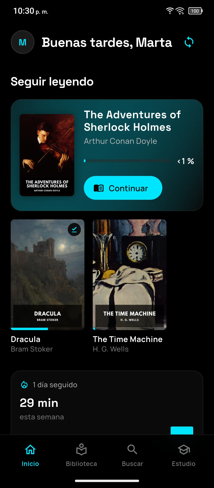](docs/assets/video/nb-books-mobile-demo-es.mp4)

*Un recorrido breve grabado en la propia app ([MP4](docs/assets/video/nb-books-mobile-demo-es.mp4)).*

| Inicio | Biblioteca | Libro |
|---|---|---|
|  | 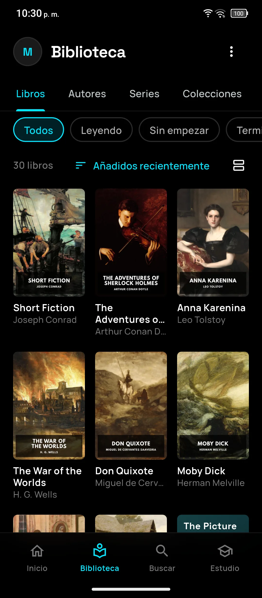 | 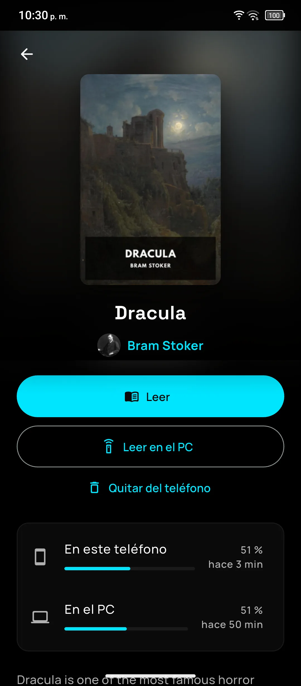 |

| Lectura | Controles del lector | Estudio |
|---|---|---|
| 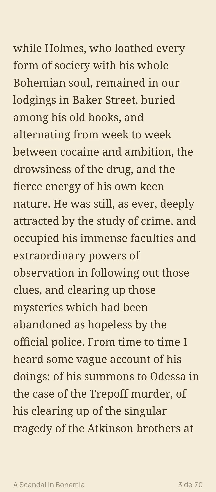 | 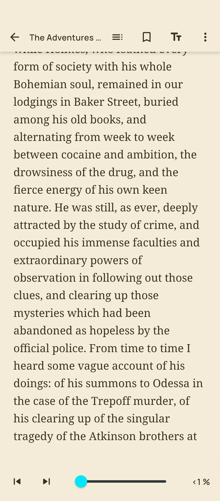 | 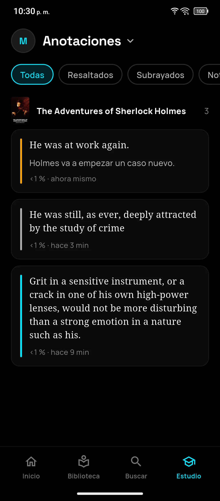 |

| Buscar | Perfil | Leer en el PC |
|---|---|---|
| 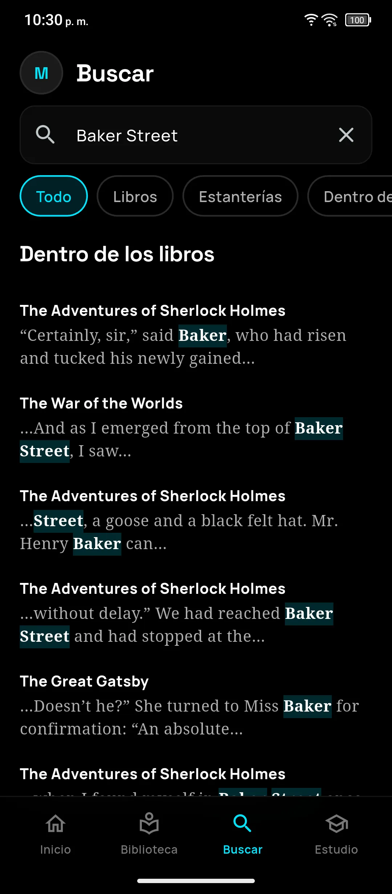 | 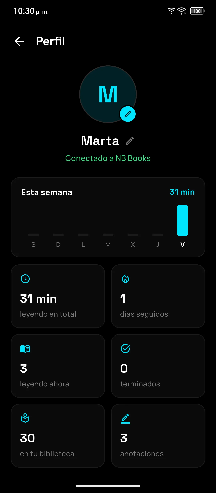 | 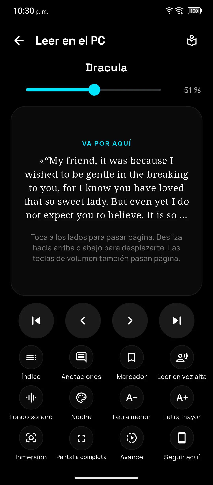 |

| Autores | Un autor | Temas |
|---|---|---|
| 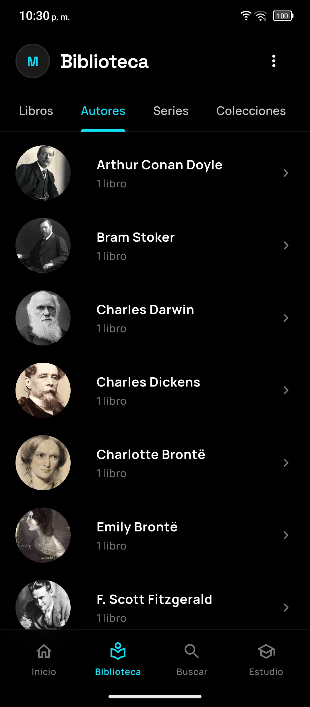 | 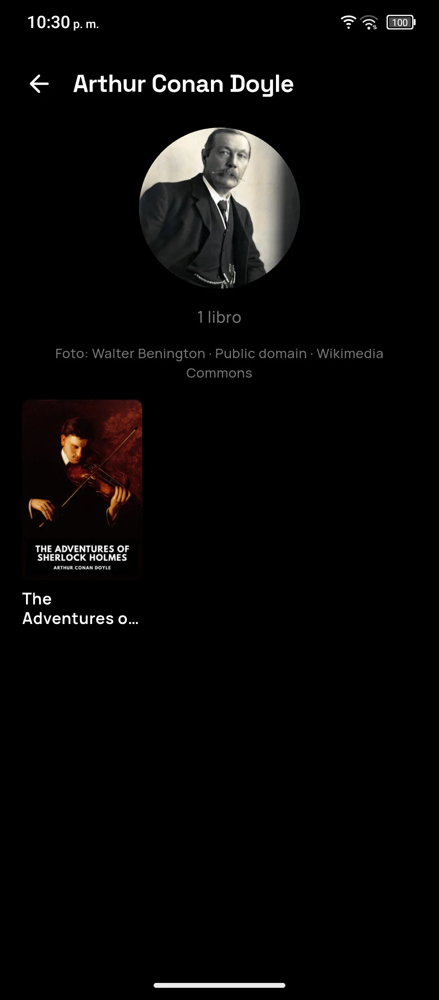 | 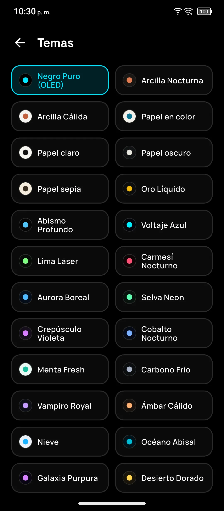 |

Los libros de estas imágenes son ediciones de dominio público de [Standard Ebooks](https://standardebooks.org), leídas
desde NB Books en un PC; las fotos de autores vienen de Wikimedia Commons y son de dominio público.

## Instalación rápida

Descarga desde la página de publicaciones y comprueba con `SHA256SUMS` y su firma Ed25519 `SHA256SUMS.sig` (ver
[cadena de suministro](docs/audit/supply-chain.md)).

| Dispositivo | Paquete |
|---|---|
| La mayoría de teléfonos Android (64 bits) | `NB-Books-Mobile-1.0.0-arm64-v8a.apk` |
| Teléfonos Android antiguos de 32 bits | `NB-Books-Mobile-1.0.0-armeabi-v7a.apk` |
| Emuladores de Android, Chromebook con Intel o AMD | `NB-Books-Mobile-1.0.0-x86_64.apk` |
| Cualquier dispositivo Android | `NB-Books-Mobile-1.0.0-universal.apk` |
| iPhone y iPad | `NB-Books-Mobile-1.0.0-ios-unsigned.ipa` (**sin probar**) |

Android 7.0 o posterior es la plataforma verificada. La edición para iOS se publica **sin probar en un dispositivo
real**, sin firma de Apple y sin PDF: hay que firmarla para instalarla. Las teclas de volumen en Leer en el PC y el
actualizador son solo de Android.

En el PC hace falta [NB Books](https://github.com/nb-digital-hq/nb-books) 1.0 o posterior, en la misma red.

Para compilar desde el código:

```bash
just setup      # dependencias, el motor de Rust y PDFium por ABI, código generado
just demo       # con libros de demostración inventados, sin PC
just apk
```

Detalles: [puesta en marcha](docs/developer/setup.md).

## Documentación

| Si quieres... | Lee |
|---|---|
| Usar la aplicación | [Manual de uso](docs/user/README.md) |
| Evaluarla para una institución | [Instituciones](docs/institution/README.md) |
| Entender cómo está construida | [Arquitectura](docs/architecture/README.md) |
| Saber por qué está construida así | [ADR](docs/adr/README.md) |
| Contribuir | [CONTRIBUTING.md](CONTRIBUTING.md) y [guía de desarrollo](docs/developer/README.md) |
| Trabajar en ella con un agente de IA | [AGENTS.md](AGENTS.md) |

## Contribuciones, seguridad y conducta

Las contribuciones son bienvenidas bajo el Developer Certificate of Origin (`git commit -s`); ver
[CONTRIBUTING.md](CONTRIBUTING.md). Las vulnerabilidades se reportan en privado como indica
[SECURITY.md](SECURITY.md). La participación se rige por el [Código de conducta](CODE_OF_CONDUCT.md).

## Licencia y marcas

Apache License 2.0; ver [LICENSE](LICENSE) y [NOTICE](NOTICE). Los nombres "NB", "NB Digital", "NB Books" y "NB
Books Mobile" y sus logotipos no se licencian con Apache 2.0; ver [TRADEMARKS.md](TRADEMARKS.md). Para citar el
proyecto, usa [CITATION.cff](CITATION.cff).
