# NB Books Mobile

<p align="center">
  
</p>

<p align="center">
  <strong>The books you choose from your PC, on your phone. Read, annotate and study, and it all lands on the same page.</strong>
</p>

<p align="center">
  <a href="LICENSE"></a>
  
  
  
  
</p>

<p align="center">
  <strong>English</strong> · <a href="README.es.md">Español</a>
</p>

---

## TL;DR

NB Books Mobile is the free, open-source phone companion of [NB Books](https://github.com/nb-digital-hq/nb-books).
Scan a QR code on your PC, choose which collections, authors or books come to your phone, and read them with the
same reading engine as the desktop: a highlight made on the phone appears on the PC in the same passage. Download
books to read offline, read them straight from the PC without downloading, study your notes and flashcards, or use
the phone as the remote of the PC reader. No account, no cloud, no telemetry. It is part of the NB Digital community
suite, under the Apache 2.0 licence.

## Features

| Area | What you get |
|---|---|
| **Pairing and sync** | QR or address-and-code pairing, PC certificate pinned by fingerprint, paginated delta sync over the local network |
| **Home** | Continue reading, your reading week and streak, today's reviews, the next book in a series, more by the author you are reading, subjects and collections |
| **Two libraries** | What you choose from the PC (collections, authors, series, subjects or single books) and books stored only on the phone, browsed by book, author, series, collection or subject with filters |
| **Reading** | EPUB, PDF and CBZ with the NB Books engine; paginated or scrolling, font, spacing and margins, table of contents |
| **Annotations** | Highlights, underlines, notes and bookmarks anchored with the same Locator as the desktop |
| **Offline** | Resumable, fingerprint-checked downloads; read without downloading from a self-trimming cache |
| **Study** | Annotations, linked notes, vocabulary and spaced repetition that reaches the same state on both sides |
| **Search** | By title on the phone; full-text across your whole library with the PC connected |
| **Read on your PC** | The phone as the remote of the PC reader (pages, chapters, contents, annotations, voice, background sound, mode, text size, immersion, auto-scroll), the volume keys turning pages (Android), and the book moving between devices at the exact sentence |
| **Profile** | Your photo and name, reading time, streak and finished books, and the storage each book takes |
| **Personalisation** | 67 themes, four of them paper themes for long reading; Spanish, English and Portuguese |

## Privacy guarantees

These guarantees are enforced by code and by automated checks; the full statement is in [PRIVACY.md](PRIVACY.md).

* **Zero telemetry and zero logs.** No analytics, no crash reporting, no usage tracking, no log files.
* **One network exit, only what you ask for.** Every connection is built in `lib/core/network/`: the PC you paired,
  GitHub only when you tap "Check for updates" on Android, and Wikimedia only if you turn on author photos. The
  reading engine opens no connections.
* **No account, no cloud.** Your books never leave your network.
* **Secrets in the keychain.** The pairing token and the PC fingerprint live in Android Keystore or iOS Keychain.

## Architecture at a glance

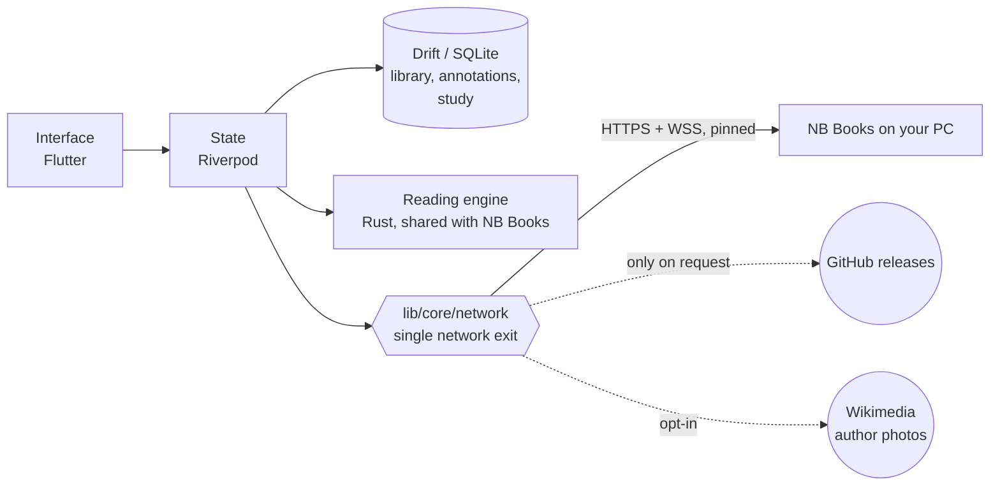

More detail in [docs/architecture](docs/architecture/README.md) (Spanish).

## Screenshots and video

[](docs/assets/video/nb-books-mobile-demo.mp4)

*A short tour recorded on the app itself ([MP4](docs/assets/video/nb-books-mobile-demo.mp4)).*

| Home | Library | Book |
|---|---|---|
| 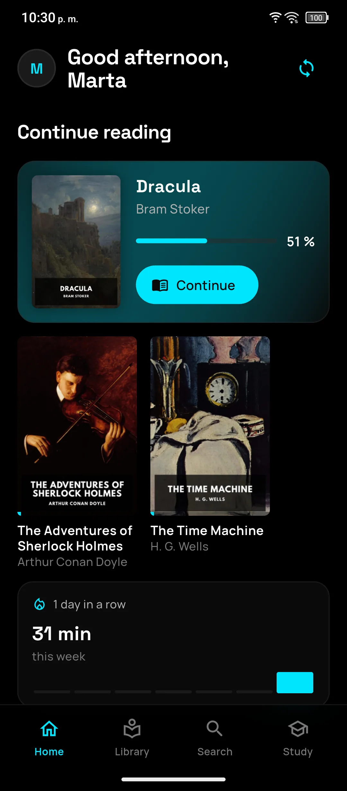 | 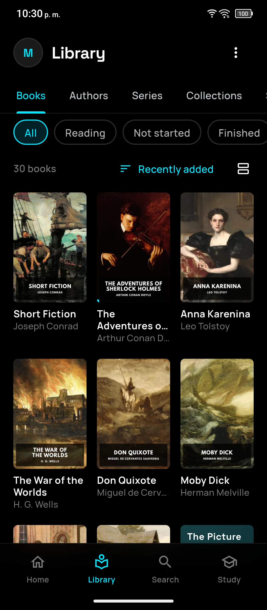 | 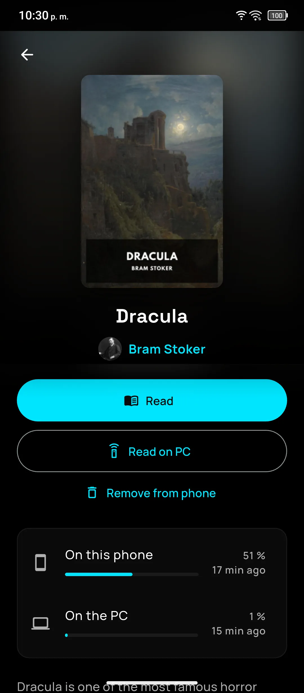 |

| Reading | Reading controls | Study |
|---|---|---|
| 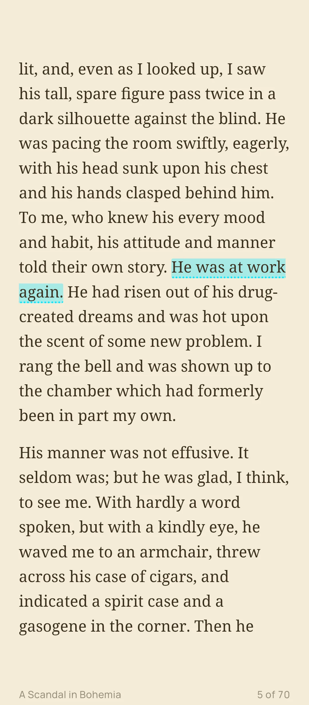 | 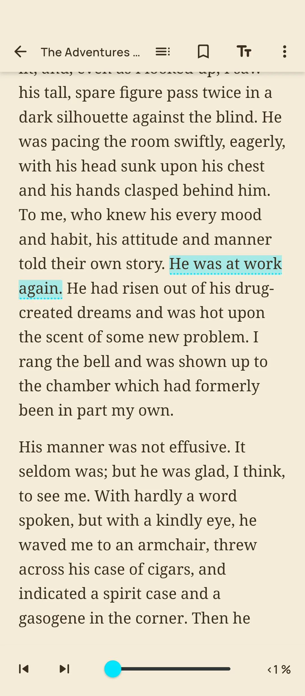 | 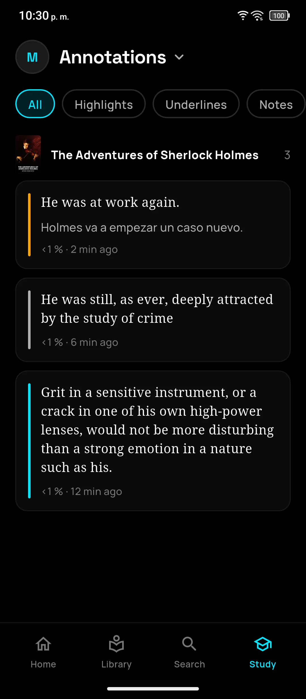 |

| Search | Profile | Read on PC |
|---|---|---|
| 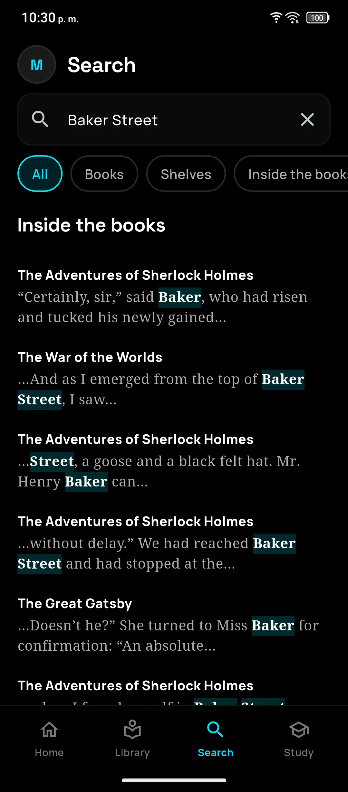 | 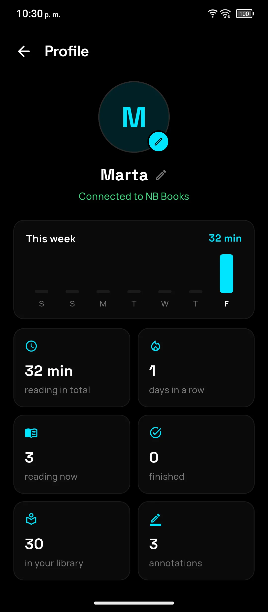 | 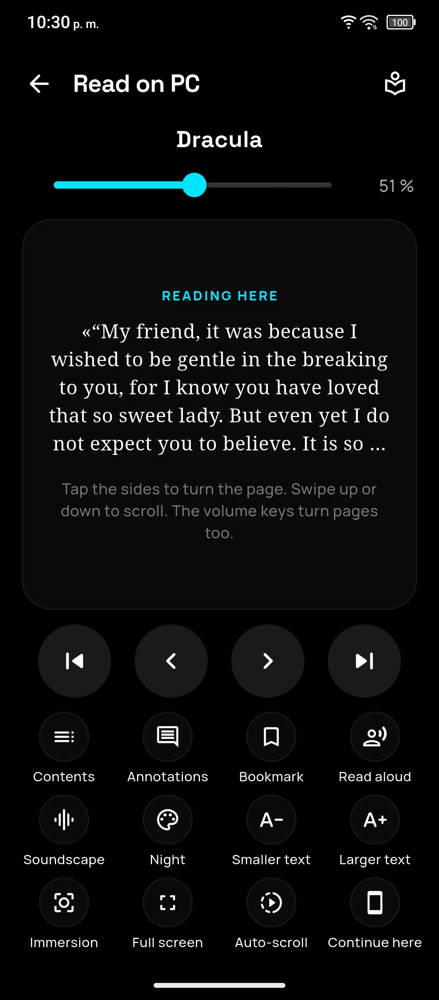 |

| Authors | An author | Themes |
|---|---|---|
| 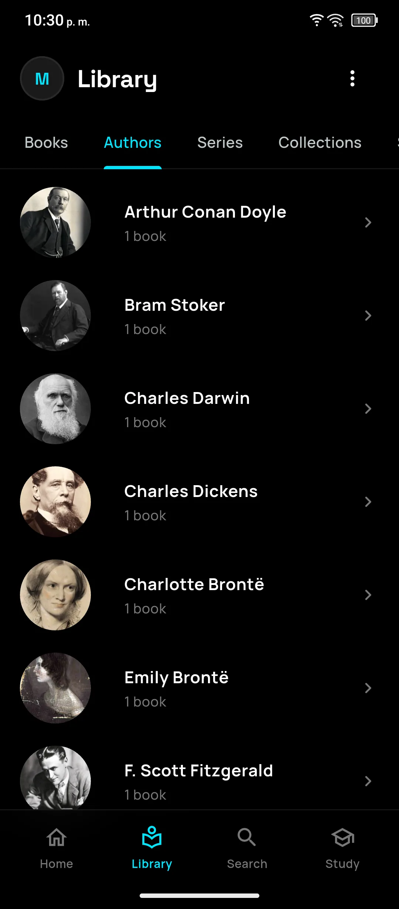 | 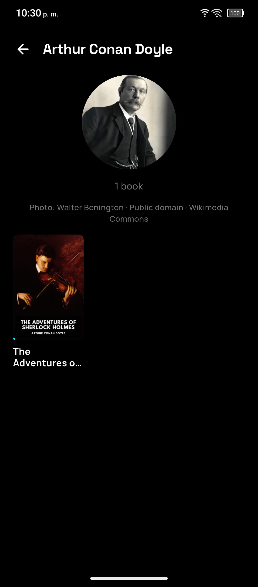 | 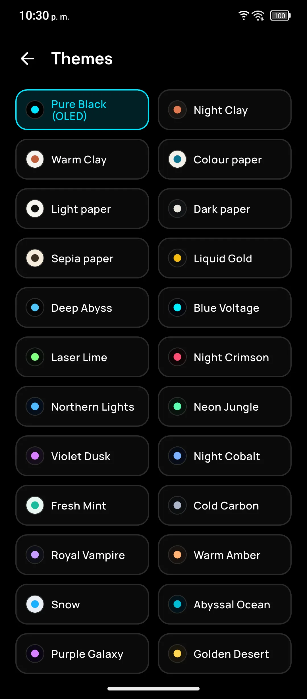 |

The books in these images are public-domain editions from [Standard Ebooks](https://standardebooks.org), read from NB
Books on a PC; the author photos come from Wikimedia Commons and are in the public domain.

## Quick install

Download from the release page and verify against `SHA256SUMS` and its Ed25519 signature `SHA256SUMS.sig` (see
[supply chain](docs/audit/supply-chain.md)).

| Device | Package |
|---|---|
| Most Android phones (64-bit) | `NB-Books-Mobile-1.0.0-arm64-v8a.apk` |
| Older 32-bit Android phones | `NB-Books-Mobile-1.0.0-armeabi-v7a.apk` |
| Android emulators, Intel/AMD Chromebooks | `NB-Books-Mobile-1.0.0-x86_64.apk` |
| Any Android device | `NB-Books-Mobile-1.0.0-universal.apk` |
| iPhone and iPad | `NB-Books-Mobile-1.0.0-ios-unsigned.ipa` (**untested**) |

Android 7.0 or later is the verified platform. The iOS build is published **untested on a real device**, without an
Apple signature and without PDF support: you need to sign it yourself to install it. The volume keys in Read on PC
and the in-app updater are Android-only.

You also need [NB Books](https://github.com/nb-digital-hq/nb-books) 1.0 or later on your PC, on the same network.

To build from source:

```bash
just setup      # dependencies, the Rust engine and PDFium per ABI, code generation
just demo       # run with fictional demo books, no PC needed
just apk
```

Details: [developer setup](docs/developer/setup.md).

## Documentation

| If you want to... | Read |
|---|---|
| Use the application | [User guide](docs/user/README.md) |
| Evaluate it for an institution | [Institution](docs/institution/README.md) |
| Understand how it is built | [Architecture](docs/architecture/README.md) |
| Know why it is built this way | [ADR](docs/adr/README.md) |
| Contribute | [CONTRIBUTING.md](CONTRIBUTING.md) and [developer guide](docs/developer/README.md) |
| Work on it with an AI agent | [AGENTS.md](AGENTS.md) |

## Contributing, security and conduct

Contributions are welcome under the Developer Certificate of Origin (`git commit -s`); see
[CONTRIBUTING.md](CONTRIBUTING.md). Report vulnerabilities privately as described in [SECURITY.md](SECURITY.md).
Participation is governed by the [Code of Conduct](CODE_OF_CONDUCT.md).

## Licence and trademarks

Apache License 2.0; see [LICENSE](LICENSE) and [NOTICE](NOTICE). The names "NB", "NB Digital", "NB Books" and "NB
Books Mobile" and their logos are not licensed under Apache 2.0; see [TRADEMARKS.md](TRADEMARKS.md). To cite the
project, use [CITATION.cff](CITATION.cff).
