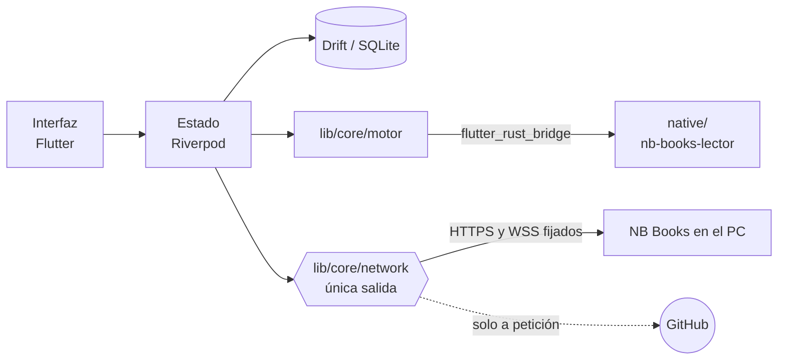

# Visión general

> **Estado:** Implementado.

NB Books Mobile es una app Flutter con un motor de lectura en Rust. La interfaz, el estado y la base de datos son
Dart; abrir un libro, sanearlo, paginarlo por recursos y calcular posiciones es Rust, el mismo código que NB Books
usa en el escritorio.

## Capas

| Carpeta | Qué hace |
|---|---|
| `lib/app/` | Widget raíz, pestañas (Inicio, Biblioteca, Buscar, Estudio) |
| `lib/core/motor/` | La única puerta al motor: `Motor` y el puente generado |
| `lib/core/network/` | Clientes HTTP y WebSocket hacia el PC con TLS fijado, y la consulta a GitHub |
| `lib/core/security/` | El emparejamiento en el llavero del sistema |
| `lib/core/i18n/` | `tr()` y los catálogos en inglés y portugués |
| `lib/data/` | Esquema de Drift, consultas y la biblioteca de demostración |
| `lib/features/sync/` | Emparejamiento, selección, manifiesto, subida de cambios y descargas |
| `lib/features/library/` | Inicio, Biblioteca y la ficha de cada libro |
| `lib/features/reader/` | El lector y sus ajustes |
| `lib/features/study/` | Anotaciones, notas, vocabulario y repaso |
| `lib/features/search/` | Búsqueda por título y, con el PC, dentro de los libros |
| `lib/features/read_on_pc/` | Leer en el PC |
| `lib/features/local_books/` | Libros guardados en el teléfono |
| `lib/features/about/` | Acerca de y el actualizador |
| `native/` | El crate que envuelve `nb-books-lector` para Dart |
| `android/.../kotlin/` | Teclas de volumen de Leer en el PC e instalador de paquetes |

## Flujo de una lectura

1. La ficha descarga el archivo (`/api/v1/archivo/{huella}`), o lo trae a la caché para leer sin descargar, y
   comprueba su SHA-256 con el motor antes de aceptarlo.
2. El lector abre el archivo con `Motor.abrir`, pide al motor el marcado saneado de cada recurso y lo pinta en una
   vista web local, sin red.
3. Cada cambio de página pide al motor el Locator del punto visible y lo guarda como posición del teléfono.
4. Resaltar, subrayar, anotar o poner un marcador guarda una anotación con el Locator del motor, marcada como
   pendiente de subir.
5. Al cerrar el lector se apunta la sesión y se sincroniza: sube lo pendiente y baja el manifiesto.
